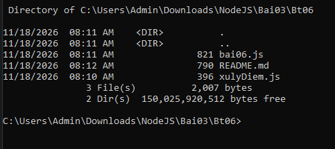
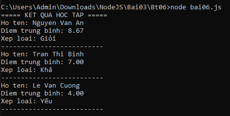

## 1. Các tập tin

- `bai06.js`: Sử dụng `require()` để gọi các hàm từ module `xulyDiem.js`, tạo dữ liệu 3 sinh viên và hiển thị kết quả học tập trên Terminal.
- `xulyDiem.js`: Xây dựng hàm tính điểm trung bình 3 môn và hàm xếp loại học tập. Sử dụng `module.exports` để xuất các hàm.

## 2. Các lệnh thực hiện

```cmd
node bai06.js
```

## 3. Kết quả thực hiện

Chương trình hiển thị họ tên, điểm trung bình và xếp loại học tập của 3 sinh viên trên Terminal.

## 4. Hình ảnh minh họa

### Ảnh chạy các bước thực hiện



### Ảnh kết quả cuối cùng

